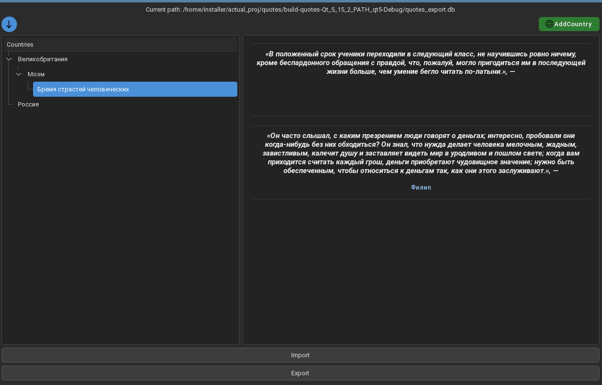

## Цифровой блокнот для читателя

**Проблема:** при чтении бумажных или электронных книг ценные мысли, идеи и цитаты часто теряются на полях и в заметках телефона. Их сложно систематизировать, быстро найти или экспортировать

**Решение:** приложение для ведения личной библиотеки прочитанных произведений и сохранения цитат. Оно связывает каждую мысль с конкретным источником (страна — автор — книга), создавая единую и упорядоченную базу знаний

### Ключевые возможности

- *Иерархическая структура:* данные организованы в виде дерева "Страна → Автор → Книга". Для отображения используется кастомная древовидная структура `CustomTree`, которая гарантирует строгую сортировку и быстрый доступ к любому элементу

- *Управление цитатами:* добавление, редактирование и удаление понравившихся фрагментов. Каждая цитата привязана к конкретной книге

- *Контекстные меню* (правая кнопка мыши) для добавления и удаления сущностей на каждом уровне дерева.
Динамическое отображение списка цитат при выборе книги

- *Надежное хранение:* Все данные (страны, авторы, книги, цитаты) сохраняются в локальной базе данных SQLite

- *Экспорт:* Создание резервной копии всей базы данных в отдельный файл SQLite

- *Импорт:* Безопасное переключение между разными библиотеками. Приложение проверяет целостность выбранного файла и позволяет в любой момент вернуться к предыдущей базе, если что-то пошло не так.